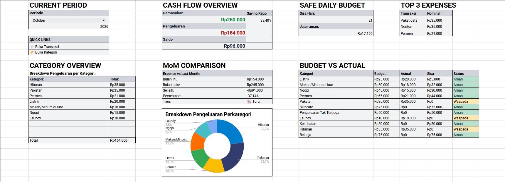
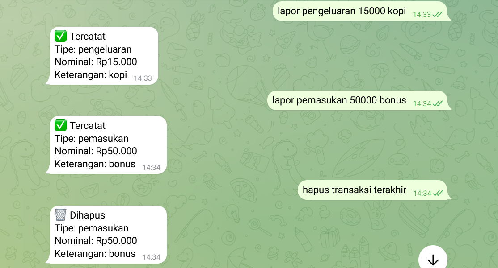

# Treasury Lite

**Pembukuan pribadi lewat Telegram + Google Sheets.**

Bot Telegram untuk mencatat pemasukan dan pengeluaran pribadi langsung dari chat ke Google Sheets, lengkap dengan dashboard, laporan otomatis, dan backup. Berjalan sepenuhnya di Google Apps Script, tanpa server sendiri dan tanpa biaya.



## Fitur

- **Catat dari chat.** Kirim `lapor pengeluaran 15000 kopi` dan baris baru langsung masuk ke sheet `Transaksi`.
- **Command lain:** `ringkasan`, `cek kondisi` (savings ratio, budget usage, forecast akhir bulan), `aman sampai kapan` (estimasi saldo bertahan berapa hari), dan `hapus transaksi terakhir` (atau `batalkan`).
- **Dropdown kategori dinamis.** Pilihan kategori otomatis menyesuaikan tipe transaksi (pemasukan atau pengeluaran).
- **Dashboard.** Periode, Cash Flow Overview, Safe Daily Budget, Category Overview, MoM Comparison, Budget vs Actual, Savings Ratio, donut chart, dan Top 3 Expenses.
- **Otomatisasi.** Reminder harian, Weekly Financial Summary tiap Minggu malam, snapshot Monthly Closing ke sheet `Histori Bulanan`, pergeseran periode Dashboard tiap awal bulan, dan backup bulanan ke Drive (menyimpan 6 terakhir).



## Cara kerja singkat

```
Telegram  --webhook-->  Apps Script Web App (doPost)  -->  Google Sheets
                              |
                        command router
```

Pesan masuk lewat webhook ke Web App, divalidasi (kunci webhook dan ID pengirim), dicocokkan ke command router, lalu hasilnya ditulis atau dibaca dari Sheets. Detail ada di [docs/ARCHITECTURE.md](docs/ARCHITECTURE.md).

Command baru cukup ditambahkan sebagai satu objek `{match, handler}` ke array `COMMANDS` di `Code.gs`, tanpa mengubah kode inti.

## Keamanan

- Token bot, User ID, URL Web App, dan kunci webhook disimpan di **Script Properties**, bukan di kode.
- Webhook hanya menerima request yang membawa kunci rahasia (`?key=...`). Request lain diabaikan tanpa log.
- Pesan dari pengirim selain `AUTHORIZED_USER_ID` diabaikan tanpa balasan.
- Log debug tidak menyimpan data pribadi.

## Setup

1. Buat bot lewat @BotFather, simpan tokennya.
2. Buat Google Sheet dengan tab `Transaksi`, `Kategori`, dan `Dashboard`. Tab `Histori Bulanan` dan `Debug` dibuat otomatis oleh script.
3. Buka **Ekstensi > Apps Script**, lalu tempel isi `Code.gs`.
4. Di **Project Settings > Script Properties**, isi:
   - `BOT_TOKEN`: token dari BotFather
   - `AUTHORIZED_USER_ID`: Telegram User ID kamu
   - `WEBHOOK_KEY`: string acak buatan sendiri
5. **Deploy > New deployment > Web app** (Execute as: Me, Who has access: Anyone). Salin URL `/exec`, lalu simpan sebagai Script Property `WEBAPP_URL`.
6. Jalankan fungsi `setWebhookOnce` sekali.
7. Pasang trigger (halaman Pemicu): `backupSpreadsheet` (bulanan), `kirimReminderHarian` (harian), `updateKategoriDropdown` (dari spreadsheet, On edit), `autoUpdatePeriodeDashboard` (bulanan, tanggal 1), `kirimRingkasanMingguan` (mingguan, Minggu), dan `tutupBulanLalu` (bulanan, tanggal 1).

Untuk update kode berikutnya, gunakan **Deploy > Manage deployments > Edit > New version**, bukan "New deployment", supaya URL webhook tidak berubah.

## Pelajaran teknis

**1. Telegram tidak mengikuti redirect 302.**
`ContentService` di Apps Script selalu membalas lewat redirect 302. Telegram tidak mengikutinya, sehingga webhook dianggap gagal dan pesan dikirim ulang. Solusinya membalas dengan `HtmlService.createHtmlOutput('ok')`.

**2. Trigger `onEdit` tidak jalan untuk baris yang ditulis script.**
`appendRow` dari bot tidak memicu trigger On edit, jadi dropdown Kategori tidak terpasang di baris baru. Solusinya memasang aturan dropdown langsung dari kode saat mencatat transaksi. Trigger tetap dipakai untuk edit manual di Sheets.

**3. Pemisah ribuan terbaca sebagai desimal.**
`Number("24.000")` di JavaScript menghasilkan `24`. Titik dan koma dibuang dulu sebelum konversi.

**4. Sel Nominal yang berubah jadi tanggal merusak penjumlahan.**
Sheets kadang mengonversi nilai menjadi tipe tanggal atau teks. Penjumlahan sekarang hanya menghitung nilai bertipe angka, dan baris yang janggal dicatat ke sheet `Debug`.

**5. Deployment baru berarti URL baru.**
URL Web App melekat pada deployment. Memakai "New version" pada deployment yang sama menjaga URL tetap, sehingga webhook tidak perlu didaftarkan ulang.

**6. Apps Script tidak bisa membaca header kustom.**
Karena itu kunci webhook dipasang sebagai parameter query. Ini bukan pengaman sekuat header, tetapi cukup menolak request acak dari luar Telegram.

## Teknologi

Google Apps Script (JavaScript), Telegram Bot API, Google Sheets, Google Drive (backup).

## Lisensi

[MIT](LICENSE)

